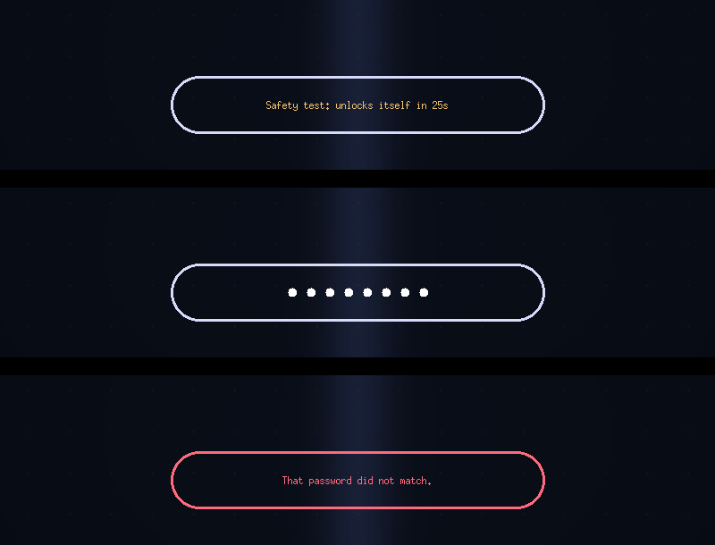
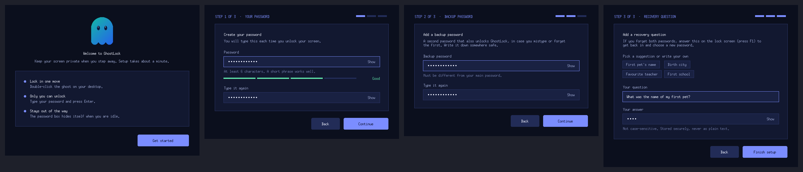
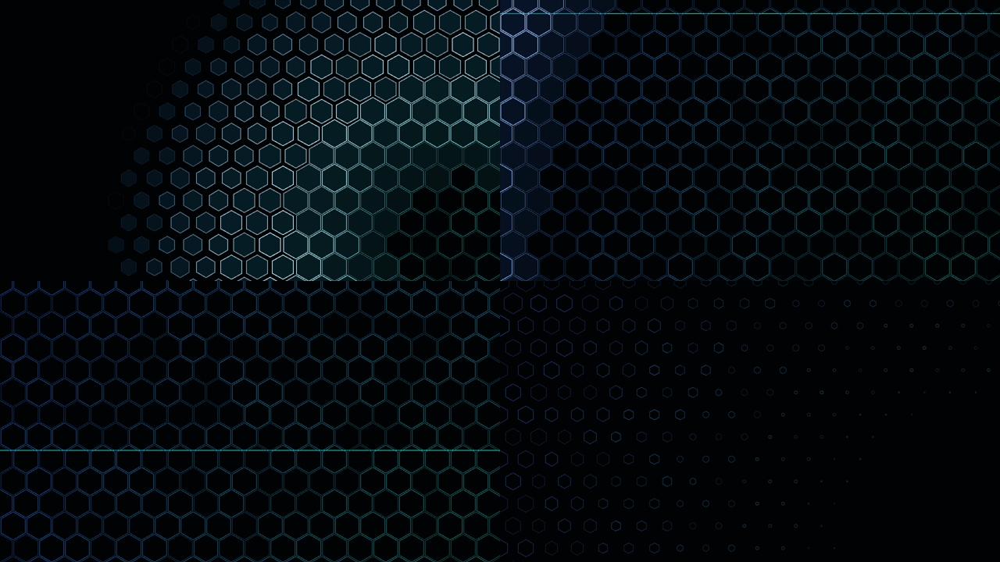
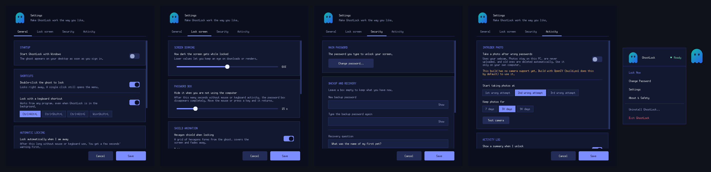

<p align="center">
  
</p>

<h1 align="center">GhostLock</h1>
<p align="center"><b>A transparent privacy screen for Windows.</b><br>
Step away from your PC without closing anything.</p>

## What is GhostLock?
GhostLock is a free **soft lock** for Windows 10 and 11. When you walk away, you double-click the ghost on your desktop. A hexagon shield forms across the screen, the display dims, and a transparent password box appears. Your apps, downloads and renders keep running underneath, and nobody sees your work until the right password is typed.

It is made for short breaks: a coffee, a quick chat, a long export you want to leave running. It is not a replacement for the Windows lock screen (`Win+L`); see [what GhostLock is and isn't](#important-what-ghostlock-is-and-isnt).

## Download
1. Open the **[Releases page](../../releases/latest)** of this repository.
2. Under **Assets**, download **`GhostLock.exe`**. This is the app itself: double-click it, and on the first start a short setup asks for your password, a backup password and a recovery question.
3. Prefer a guided install with Start Menu entry and uninstaller? Download **`Setup.exe`** instead and click **Install**.

Both files are listed with SHA-256 checksums in `SHA256SUMS.txt` on the same page. Windows 10 / 11, no account, no internet needed. Free and open source (MIT).

<p align="center"></p>

## Why GhostLock?
Downloads, renders, long exports, a quick coffee break: you want people not to see your screen, but you don't want to close apps or sign out. GhostLock covers the screen, lets everything keep running underneath, and only asks for a password when you come back.

- **Double-click the ghost** to lock instantly. Single-click opens the menu.
- **Hexagon shield animation.** A sci-fi grid of hexagons forms from the ghost, covers the screen and fades away. Choose the pattern, color and speed, or turn it off.
- **Transparent password box.** Just a clean capsule. No blur, no clutter.
- **Hides when idle.** After about 15 seconds without mouse or keyboard activity the password box disappears completely. Move the mouse or press a key to bring it back.
- **Two ways in.** A main password and a backup password, plus a recovery question if you forget both.
- **Private.** No account, no internet, no tracking. Passwords are stored only as salted hashes on your PC.
- **Easy to remove.** Uninstall from the ghost menu, Windows Settings or the Start Menu.

## Install
1. Open the [latest release](../../releases/latest) and download **`Setup.exe`** (or just run `GhostLock.exe`, see Download above).
2. Run it and click **Install**. It installs for your Windows user only and normally needs no administrator rights.
3. Follow the short setup: choose a password, a backup password and a recovery question.
4. Look for the ghost on your desktop. Double-click it to lock.

> **Windows says "Windows protected your PC"?** GhostLock is a new, unsigned app, so SmartScreen may warn you. Click **More info > Run anyway**. Some antivirus tools are cautious about any program that covers the screen; you can read the full source in this repository and build it yourself.

<p align="center"></p>

### Upgrading from an older GhostLock
Just run the new `Setup.exe`. It checks your PC for older GhostLock copies first: running programs, "Start with Windows" entries, startup shortcuts, scheduled tasks, old install folders and old Apps entries.

- If it finds any, it **lists them and asks your permission** before removing anything. Nothing outside GhostLock is touched.
- **Start fresh** (on by default) also removes your old passwords and settings, so the setup wizard opens clean. Switch it off to keep them.
- Items shared with all users (for example an old copy in *Program Files*) need administrator permission. Windows shows **one** prompt for those, and only if such items exist. If you decline, they are left in place and the installer tells you.
- After cleanup it installs the new version and opens the setup wizard.

You can also start the new `GhostLock.exe` directly: if older leftovers exist, it offers the same cleanup instead of running next to the old version.

## How to use it
| Do this | To get this |
| --- | --- |
| Click the ghost | Open the menu (Lock Now, Change Password, Settings, About, Uninstall, Exit). Drag the ghost to move it |
| Double-click the ghost | Lock instantly |
| `Ctrl+Alt+L` (changeable in Settings, can be turned off) | Lock from anywhere. On keyboard layouts where `Ctrl+Alt` is the AltGr key, pick another combination such as `Ctrl+Shift+L`. |
| Type your password, press `Enter` | Unlock (main or backup password) |
| `Esc` | Clear what you typed |
| `F1`, `Ctrl+R` or right-click | Recovery question (forgot your passwords) |
| Stay idle ~15 s | The password box fades out completely; any movement brings it back |
| `Ctrl+Alt+Del` | Always available. This is your emergency exit |

Your **first lock is a safe test**: it unlocks itself after 25 seconds. After one successful unlock it stays locked until you enter a password.

## Settings
<p align="center"></p>

<p align="center"></p>

- **General:** start with Windows, double-click to lock, the global hotkey, automatic lock after 1-30 minutes of inactivity (a short warning appears first; any input cancels it, and it never fires during full-screen video or games), lock when the PC wakes from sleep, and an optional weekly update check.
- **Lock screen:** the hexagon shield animation (on/off, pattern, color, speed, preview), how dark the screen gets (lower = you can watch downloads or renders), how long before the password box hides, and a short custom message shown in the password box.
- **Security:** change your password, backup password and recovery question.
- **Activity:** a log of failed unlock attempts, a "while you were away" summary after you unlock, and the optional intruder photo (below).

### Exited GhostLock? How to start it again
- Open the **Start menu** and type **GhostLock**, or double-click the **GhostLock** icon on your desktop (both are created by `Setup.exe`, also when your Desktop is synced with OneDrive).
- Running `GhostLock.exe` again while it is already running does not open a second copy: it brings the ghost back and opens its menu.
- Exiting asks for confirmation and tells you how to start it again. With *Start with Windows* on, it also comes back at your next sign-in.

### Intruder photo (optional, off by default)
When someone enters a wrong password, GhostLock can take one photo with the webcam, starting at the 1st, 2nd or 3rd wrong attempt (your choice, at most 5 photos per lock). After you unlock you see the photos and times.

- You must turn it on yourself and confirm a consent prompt. Use it only on your own PC.
- Photos are saved only on this PC in `%APPDATA%\GhostLock\intruders` and are never uploaded. Old photos are deleted automatically (7, 30 or 90 days). You can delete everything from the Activity window.
- The webcam light turns on while a photo is taken, and Windows must allow desktop apps to use the camera (Settings > Privacy > Camera).
- It needs the camera build (the default). `.\build.ps1 -NoCamera` leaves it out.
- *Test camera* in Settings shows a preview so you know it works.
- If the camera is missing, blocked or busy, the lock works exactly the same, just without a photo.

## Important: what GhostLock is (and isn't)
GhostLock is a **soft privacy screen** for short breaks. It is **not** a replacement for Windows Lock (`Win+L`), BitLocker or account passwords. Windows keeps `Ctrl+Alt+Del`, UAC prompts, restart and sign-out available by design, and someone with access to your PC could end the app from Task Manager. For real security, use Windows Lock. See [SECURITY.md](SECURITY.md).

## FAQ

**I forgot my password.** On the lock screen press `F1`, answer your recovery question and choose a new password. Or use your backup password.

**Can I turn off double-click?** Yes: Settings > General.

**Where is my data?** `%APPDATA%\GhostLock\config.json` (hashed passwords and settings) and `ghostlock.log` (errors only).

**How do I uninstall?** Ghost menu > *Uninstall GhostLock…*, or Windows Settings > Apps, or the Start Menu shortcut.

**Does it need internet or admin rights?** No internet. Admin rights only when removing an old machine-wide install (see Upgrading).

**The old version still starts with Windows.** Run the new `Setup.exe` and accept the cleanup. GhostLock also re-points its own "Start with Windows" entry to the running installed copy each time it starts.

## For developers
Windows 10/11 and Python 3.10+ (Tkinter is included with the standard installer).

```powershell
py ghostlock.py                       # run from source
py -m unittest discover -s tests      # tests
py -m pip install -r requirements.txt   # camera support (optional)
.\build.ps1 -InstallPyInstaller       # once
.\build.ps1 -SetupOnly                # builds dist\Setup.exe (includes OpenCV for the intruder photo)
.\build.ps1 -SetupOnly -NoCamera      # smaller build without it
```

```text
ghostlock.py        entry point and app controller
gl_core.py          config, hashing, brute-force guard, Windows integration (no GUI)
gl_theme.py         palette, DPI scaling, custom widgets
gl_windows.py       setup, installer, uninstaller, settings, about, floating ghost
gl_lock.py          the transparent lock screen
gl_legacy.py        finds and removes older installs (with permission)
gl_shield.py        hexagon shield lock animation
gl_system.py        global hotkey, idle auto-lock, wake detection, hang watchdog
gl_security.py      attempt log and intruder photos
gl_camera.py        webcam capture (OpenCV, optional)
gl_update.py        optional update check
assets/             logo and icons (regenerate with tools/make_icons.py)
```

Contributions are welcome. See [CONTRIBUTING.md](CONTRIBUTING.md) and [CHANGELOG.md](CHANGELOG.md).

## Credits and license
Created by **MD ABID HASAN**, published by **MDexpLab**. Copyright (c) 2026 MD ABID HASAN / MDexpLab. Released under the [MIT License](LICENSE). Please keep attribution in distributions; modified builds should not be presented as official MDexpLab releases.
